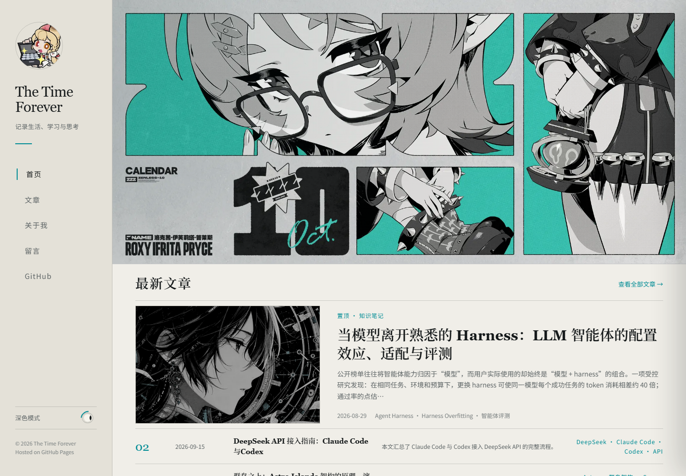

# 月历自动更新验收记录

验收日期：2026-10-16。

## 官方资源与下载器

| 项目 | 实测结果 |
| --- | --- |
| 2026 年 1—10 月历史原图下载 | 10/10 月成功，共 20 张；逐张解码、尺寸和 SHA-256 检查通过 |
| 生产脚本逐月发现与下载 | 10/10 月验证通过；源文件 SHA-256 与研究阶段逐张一致 |
| 复核过程中的网络波动 | 3、4、6 月首次生产复核遇到 URLError，重跑成功；原始失败保留在 JSON 中 |
| 历史复核是否改写首页 | 两张图及元数据校验值保持不变 |
| 10 月 dry-run | 两张官方 PNG 下载成功，生成 JPG 数据，未覆盖首页 |
| 10 月实际替换与构建 | `--year 2026 --month 10 --build` 成功，生成 25 个 Astro 页面及响应式 WebP |
| 已更新月份再运行 | 返回 `already-updated`、`changed=false` |

详见 [研究原始数据](calendar-history-2026.json)与 [生产脚本复核数据](calendar-replay-2026.json)。复核包含真实网络请求；失败注入测试使用隔离目录和合成图片。

## 失败保护测试

执行 `python -m unittest discover -s scripts/tests -v`，19 项测试全部通过；GitHub Ubuntu runner 上也通过了相同的 19 项测试。测试覆盖：

- 网络超时及有限 GET 重试，密码 POST 不重复提交。
- 公告未发布、密码错误、缺少手机版。
- 下载不完整、图片损坏、版本方向错误、候选重复。
- 第二张替换失败时恢复第一张、构建失败时恢复两张图及元数据。
- 中断事务恢复、成功事务清理后保留新图。
- dry-run 保持所有站点文件不变。
- 重复运行跳过网络、强制复核相同文件不更新时间戳、文件哈希变化时重新修复。
- 拒绝非官方跳转、未在公告中出现的分享、压缩包候选。

## 页面检查

应用 `frontend-testing-debugging` 技能；当前会话未提供 Browser 插件，使用已安装的 Playwright 1.62.1 / Chromium。

检查环境为本地生产预览 `http://127.0.0.1:4321`。流程：加载首页 → 验证 10 月主视觉与响应式图片 → 切换主题 → 打开手机导航并按 Escape 关闭 → 打开、关闭留言板。

| 检查 | 结果 |
| --- | --- |
| 页面身份与有效正文 | `/`、`/posts/`、`/about/` 均为 HTTP 200；未知地址为 HTTP 404 并显示站点 404 页面 |
| 框架错误覆盖层 | 未出现 |
| 运行时错误 | 未捕获 JavaScript 异常；404 检查产生预期的资源 404 控制台记录 |
| 桌面视口 | 1440×1000，读取桌面 WebP，页面无横向滚动 |
| 手机视口 | 390×844，读取手机 WebP，页面无横向滚动 |
| `alt` | `《绝区零》2026年10月官方月历壁纸` |
| 主题切换 | `data-theme` 从 light 切换为 dark |
| 手机菜单 | 打开后 `aria-expanded=true`，Escape 后恢复 false |
| 留言板 | 打开后取消 inert、焦点移至关闭按钮；关闭后恢复 inert |
| 页面结构 | 原有图片导入、Image/getImage、srcset、CSS 与主视觉布局保持原结构 |

随后对线上站点 `https://the-time-forever.github.io` 重复页面与桌面/手机图片检查，结果一致。线上优化图片 URL 与本地构建相同，`alt` 为 2026 年 10 月，未出现横向滚动。线上主题切换从 light 变为 dark。完整 HTTP、标题、图片 URL 和视口数据见 [线上检查记录](calendar-site-check.json)。本文底部保留线上截图，手机截图为切换后的深色模式。

## GitHub Actions 与 Pages

仓库权限与配置已核查：默认分支 `main`，当前无 ruleset，Pages 使用 workflow 部署。

| 环节 | 实际执行记录 | 结果 |
| --- | --- | --- |
| 实现提交 | [`64def87`](https://github.com/The-time-forever/The-time-forever.github.io/commit/64def87cfa26bb10f5f47b38b9b34b58b74acb18) | 已推送 main |
| 首次 10 月自动更新 | [运行 38895272794](https://github.com/The-time-forever/The-time-forever.github.io/actions/runs/38895272794) | 成功；下载、19 项测试、npm ci、25 页构建、提交、推送与部署触发均通过 |
| 机器人更新提交 | [`95f09a8`](https://github.com/The-time-forever/The-time-forever.github.io/commit/95f09a80a6b81c51a145dac2515c27addba593ef) | 仅修改两张 JPG 和 calendar.json |
| 显式 Pages 部署 | [运行 38895354002](https://github.com/The-time-forever/The-time-forever.github.io/actions/runs/38895354002) | workflow_dispatch，构建与 deploy 两个 job 均成功 |
| 同月第二次自动更新 | [运行 38895446998](https://github.com/The-time-forever/The-time-forever.github.io/actions/runs/38895446998) | 成功，already-updated、changed=false；未生成新提交或重复部署 |
| 线上结果 | [首页](https://the-time-forever.github.io/) | 桌面及手机版均显示 10 月图，说明文字正确 |

第二次运行后远程 main 保持 `95f09a80a6b81c51a145dac2515c27addba593ef`。机器人使用默认 `GITHUB_TOKEN` 推送后，由同一更新 job 显式调用部署工作流，已验证这一链路可以完成 Pages 发布。首次实现提交触发的旧版本部署被更新版本的并发部署取消，最终生效的是 10 月图片提交。

机器人提交同步到本地后，两张 JPG 的字节 SHA-256 与 metadata 一致：

```text
desktop 438ba57781c7c556a2a015a444703099e99f6a5b4422a0a74777beedbd3613e4
mobile  cf48d56ea7412908985e51a66e8b37ab2eaa10fa6858ebf2ce77773bdd0f5e89
```

## 已知边界

- 每日定时触发由 GitHub 调度；本次完整链路通过手动触发同一更新 job 验证。
- 官方变更密码、目录命名、API 或下载权限时，程序按失败保护保留旧图并报告；后续恢复按文档操作。
- 国际服 Google Drive 路径已验证到公开文件夹访问，生产自动下载采用国服 Minas。
- `npm ci` 使用现有锁文件，报告 11 个依赖审计问题；本次保持现有依赖版本与博客功能。

## 截图




